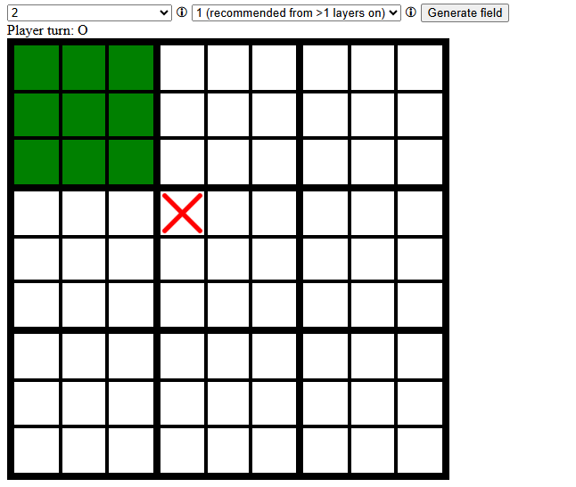
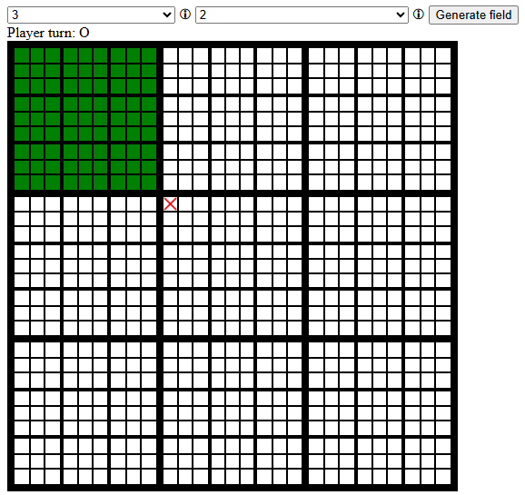

# Tic-Tac-Toe-Xtended
## Description:
Tic-Tac-Toe-Xtended or TTT-X is a game of Tic-Tac-Toe where you can explore many different ways of playing Tic-Tac-Toe. Inspired by the game "Ultimate Tic Tac Toe", where each of the 9 cells within the Tic-Tac-Toe field contain another field of Tic-Tac-Toe (which makes a total of 2 layers), TTT-X goes beyond by allowing you to create even more layers (theoretically up to as many as you want, however limited to 3, the largest size I think is reasonable) by generating the field and game logic with recursive algorithms. You can also modify the mode that is played: In Ultimate-Tic-Tac-Toe, after each move, there is a playable area that is selected after each move. It does not happen randomly: For example, if you place an X into the middle field on the top-right cell, the next O has to be placed anywhere in the top-right field.* To generally describe that, the playable area after each move is the cell-position you clicked in, but N layers above, where N is 1 for Ultimate Tic-Tac-Toe. TTT-X lets you choose that N value from 0 (I defined that 0 just means you can place the next X or O anywhere you want without restrictions) up to Z - 1 layers, whereas Z is the number of layers in the current game (Z = 1 for normal Tic-Tac-Toe, Z = 2 for Ultimate Tic-Tac-Toe). You can also choose a mode that increments/decrements/randomizes N after each move.

*note: If the playable area is fully occupied, it will shift to the whole board instead.

 

Here, you can see the default settings for Ultimate Tic-Tac-Toe. Z = 2 (each cell contains one field), N = 1 (The next move has to be placed in the top left field because X was placed in the top left one layer below.)

Here, you can see another field where Z = 3 and N = 2.

## How to play
At the top, you can see two input forms (with info icons that explain the role of Z and N) and a "Generate Field" button. Choose the according Z and N value you want to play with and click on the button. The field will be recursively generated as well as with the game logic. Now, below the input forms, it says whether it is X or O's turn. One player is X, the other player is O. X starts by default. After each click, a cell will be occupied by X or O and the turns will switch from X to O and vice versa. In order to win a field, there must be 3 X's or O's aligned horizontally, vertically or diagonally. After you win within a field, that field will be yours (if X won within the field, the Tic-Tac-Toe field will have the value X. If you play with only 1 layer, you win instantly, because there is no bigger field.). Like that, you can occupy bigger and bigger fields until eventually, you win within the 9 big cells of the whole Tic-Tac-Toe board. If that happens, you win.

## Installation
The project only contains source code. To run it, you just need to download everything and open it using a local server (VSCode's Live Server extension is recommended). Opening directly in file explorer may cause unexpected bugs.

## Implementation

### index.html
This file forms the blueprint of the whole website, such as any other index.html file. It contains elements assigned to a class, name or id (so that I have access to these elements in the JS and CSS files) that are mostly empty (except for the input fields, info-boxes etc.) and connects itself to styles.css and script.js. Script.js is imported as a module, so it is easier for me to handle multiple JS files at once.

### styles.css
Styles.css describes how the elements within the HTML file should be displayed. It includes the pop-up of the info text when the cursor hovers over the info icon, configures board, cell and button sizes and the border properties of each cell. Last but not least, it describes how the overlay image should be displayed when there is a field winner and the field gets replaced by an X or O image. Because the field is recursive and the number of cell vary depending on the settings, I thought that the border sizes should be half of the original size after each layer depth. To implement that, I used css variables that are configured when the board is generated in the next file, script.js.

### script.js
The whole game logic and board generation are executed here. It does that with the help of functions from functions.js imported as "LoFu" (for "Logic Functions"). It first generates the input forms via the execution of "generate_depth_form()" and "generate_mode_form()" before adding an event listener to the form when it gets submitted. There, it extracts the form data and checks with the help of check_errors() whether the input is valid. If the input is not valid, script.js throws an error with the error() function. If everything is fine, it tries to clear previous error messages and finally goes on to generate the whole game. This includes deleting the previous board (if there is one) with delete_previous(), generating the board with generate_board(), resetting the player turn to X with update_player_turn() and finally, generating the game logic with generate_game_logic().

### functions.js
This file contains the declaration of all functions for the core of the game. Not all functions get exported to script.js, many of the functions are declared in order to be used in other functions within functions.js, mainly to achieve a more understandable code overview. These are all the functions within the file (with a short description):
- generate_depth_form(depth_limit, depth_select)
    - Directly appends options to the depth form with a for loop iterating from depth_limit (int) to 0.
- check_errors(max_depth, depth_limit, mode)
    - Checks whether input values (max_depth and mode) actually only contain values that the form offers. 
- error(error_div, error_message)
    - Deletes previous error messages, makes an error message appear (with the value of error_message) and throws an error to the console.
- delete_previous(board)
    - Deletes the previous game board if there is one
- generate_board(parent, depth, max_depth)
    - Recursively generates the board by creating 9 cells and appending them to the parent attribute. Also sets border widths depending on the depth, sets important cell attributes for later functions, and generates the clickable field buttons in the last iteration.
- generate_game_logic(buttons, mode, max_depth)
    - Creates a click event listener for all buttons within the field, checks whether the click is in a valid field and accordingly handles errors and uses the wincheck(), gameover(), update_player_turn(), choose_select_depth() and activate_cells() functions. 
- update_player_turn(X_turn)
    - Simply updates the player turn text below the form each time the button is clicked or a new board is generated.
- choose_select_depth(mode, select_depth, init, max_depth)
    - Handles N for modes where N changes after each move (modes "upwards each move", "downwards each move", and "random each move" to be specific.)
- activate_cells(max_depth, select_depth, cell)
    - Selects the playable area of the next move depending on N, the clicked cell's position and whether the playable area is fully occupied.
- wincheck(cell, X_turn)
    - Iterates through the field of the clicked cell. Creates an array of size 9 containing of 1s and empty strings where 1 represents the cells that have the same value as the player that clicked the cell (If X clicked a cell within a field and the array consists of [1, 1, 1, 0, 0, 0, 0, 0, 0], that means that the first row contains of Xs). Goes on to compare that array to any of the 8 hard-coded win-cases and if one win-case matches, the win variable turns true. If there is a win and the layer of the win is the most outer layer (containing of the biggest fields), gameover() gets called. If there is a win and the layer is not the most outer layer, the wincheck() function gets called again on the layer above and the update_cells() function is called.
- update_cells(win_cell, X_turn)
    - Updates the field to display the image of the field winner and deactivates all buttons within the field.
- gameover(X_turn)
    - Ends the game by deactivating all buttons and displaying who won the game.

## Design choices
I first planned on creating an actual web-app with a frontend and backend. However, I found out that this would not be needed, since I liked the idea of a website that is actually light-weight but rich in logic. I thought that this would represent what we learned at CS50 better; we looked at bare coding logic way more than clean UIs, frontend-backend communication and APIs. 

I left out a system that detects draws and properly ends the game when a draw is detected, because I thought that in a draw, eventually, all cells will be occupied anyways and the implementation of a draw-detector would create big effort without a big difference.